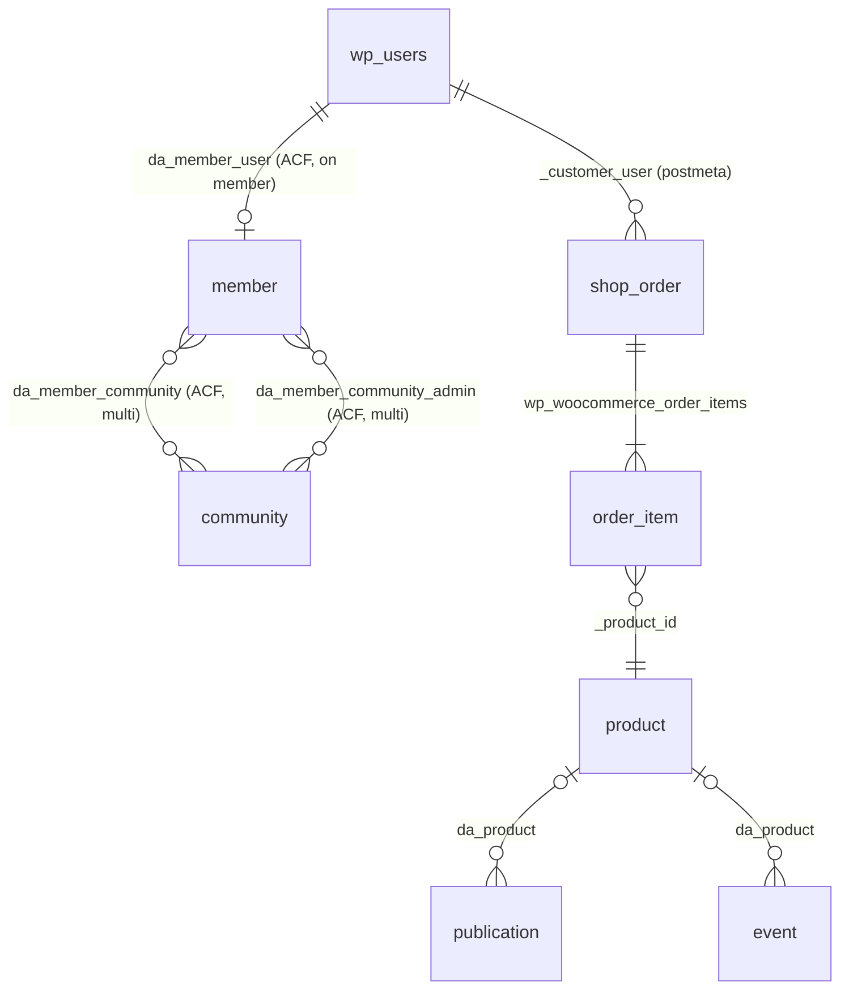

# WordPress database analysis

Source: `.data/2026-11-09_wordpress-database_export.sql`, an anonymised MySQL 8.4 dump with 75 tables and the `wp_` prefix.
All numbers below are reproducible with `scripts/analyze/run.sh`. Raw output is written to `.data/wp-analysis/`.

> **Anonymisation caveat.** Emails, names, IBANs, phone numbers and street addresses are replaced with
> placeholders such as `user_<id>@example.com`, `TestVorname_<id>` and `AT99TESTIBAN…`. Placeholder IDs differ between
> tables, so emails can't be compared across tables (for example user ↔ member, or guest orders ↔ users).
> Every user's password hash is one of two dummy values. Relationships stored as IDs are intact.
> **Post slugs are anonymised too:** every published post's `post_name` is `post-<id>` (members, communities, events, news,
> pages, publications), while the live site has real slugs (e.g. `/veranstaltung/orf-lange-nacht-der-museen-2/`).
> **Not anonymised:** attachment file names (`_wp_attached_file`, attachment titles) and old slugs (`_wp_old_slug`). Some
> certificate PDFs and many old slugs carry the person's real name, so handle the dump as personal data.

---

## 1. The big picture

The site isn't a plain "WordPress users" setup. A person exists in up to three places:

| Concept | Where it lives | Count |
|---|---|---|
| **Login account** | `wp_users` + `wp_usermeta` | 1,832 |
| **Member profile** (the person's data) | CPT `member` + ACF fields in `wp_postmeta` | 2,940 |
| **Organisation** (company, school, studio) | CPT `community` + ACF fields | 152 |
| **Shop orders** | CPT `shop_order` (legacy WooCommerce storage) | 1,142 |
| **Products** | CPT `product` | 248 |

The login account is thin. Almost all personal data (name, address, member number, status, IBAN, portfolio and so on) is on the
**member post**, not on the user.

---

## 2. Users (`wp_users`)

- **1,832 users.** Roles: `member` 1,819, `administrator` 11, no role 2.
  There's no `customer` role: shop buyers are also `member`s.
- Registered 2019–2026. 1,192 of them were registered in 2020, which looks like a bulk import at launch of the current site
  (the WP All Import tables are present but empty).
- **Password hashes** use the phpass format (`$P$B…`) for all users. Payload can't verify these natively.
- `wp_usermeta` is mostly WP and admin UI state. The parts that matter:
  - `first_name`, `last_name` (all users)
  - WooCommerce `billing_*` (396 users) and `shipping_*` (250 users)
  - `wp__stripe_customer_id` (218)
  - `description_en` and `wpseo_*` (author bios and SEO, about 139 users, probably staff)
  - `_mitgliedsnummer`, `mitgliedsnummer`, `da_number` (1 user each, leftovers)

### Users ↔ member profiles

| | Count |
|---|---|
| Member posts with `da_member_user` set | 1,794 |
| …of which the linked user exists | 1,781 (13 point to deleted users) |
| Users with no member profile | 54 (10 admins, 43 `member` role, 1 no role; 12 of them have orders) |
| Users linked to **more than one** member post | 3 (users 173, 231, 510), plus 5 member posts with the bogus value `0` |

`member.post_author` is always a site admin, never the linked user. Only the ACF field `da_member_user` connects them.

---

## 3. Member profiles (CPT `member`)

### Post status

| post_status | total | with login | without login |
|---|---|---|---|
| `publish` | 1,296 | 1,167 | 129 |
| `pending` | 1,627 | 619 | 1,008 |
| `draft` | 11 | 2 | 9 |
| `private` | 6 | 6 | 0 |

`publish` means the profile is public in the member directory. `pending` holds the newsletter-only contacts (573 with only
`newsletter`) and former members: designaustria confirmed that a profile is set to pending when the member leaves.
Only published profiles are migrated (plan §3.1).

### Membership status: `da_member_status` (multi-checkbox)

Current ACF choices: `yp` Young Professional, `student`, `retiree` Pensionist:in, `standard`, `community` Firmenmitglied,
`institute` Bildungsmitglied, `honorary` Ehrenmitglied, `president` Ehrenpräsident:in, `team`, `board` Vorstand,
`bildrecht` (Bildrecht, the image-rights collecting society), `newsletter`.
A legacy value **`active`** that's no longer among the choices appears on 126 pending profiles.

| flag | publish | pending |
|---|---|---|
| standard | 830 | 357 |
| community | 136 | 52 |
| retiree | 114 | 46 |
| yp | 79 | 170 |
| student | 57 | 78 |
| honorary | 48 | 17 |
| institute | 17 | 0 |
| team | 10 | 8 |
| bildrecht | 209 | 109 |
| newsletter | 4 | 647 |
| active (legacy) | 0 | 126 |
| *(empty)* | 15 | 250 |

The field mixes several unrelated things:
- **membership tier**, which is billing-relevant: standard / yp / student / retiree / community / institute / honorary
- **roles**: team / board / president
- **add-ons**: bildrecht
- **marketing**: newsletter

77 profiles have a `da_member_deathyear` (deceased members, often honorary).

### Member number: `da_member_id` ("Mitgliedsnummer")

- 6 digits (`012345`) for 2,755 profiles. `000000` is a placeholder for "no number".
- With a suffix (`012345-2`, `000000-17`) for 202 profiles. These are mostly **people belonging to an organisation**:
  the prefix is the organisation's `da_community_id`, and the suffix numbers the people in it.
- 16 member numbers appear on more than one **member post** (35 posts in total). WP users aren't involved: logins have no
  member number. Comparing the fields that weren't anonymised gives four patterns:

  | Pattern | Numbers | What it is | Migration consequence |
  |---|---|---|---|
  | **Placeholder collision** (`000000-11/-52/-60/-63`) | 4 (11 posts) | Different people (different gender, avatar and job), mostly designaustria staff in community 1676. The placeholder number was reused. | Not duplicates. Keep them all and treat `000000*` as "no number". |
  | **Bulk copy** (IDs 25015–25022) | 6 | The original is a fuller *published* profile without a login. The copy was made by a script around 2021/22: it keeps the original `post_date` (2011-05-06), is *pending*, has status `standard`, often carries the login link, and its content is otherwise near-identical (0–1 differing fields). | Same person. Merge: content from the original, login from the copy. Status conflicts (e.g. `honorary` vs `standard`) need a rule. |
  | **Re-registration** (`011685`, `012477`, `081430`) | 3 | An old *pending* profile without a login (2011/2018), plus a new *published* profile with a login (2022/23) that has rewritten content. | Same person. The newer profile wins; the old one is history. |
  | **"Duplicate Post" copy** (`_dp_original` set: `012826`, `081731`, `110001`) | 3 | An editor cloned a profile and didn't change the number (and in one case not the login link either: user 231). 081731 and 012826 are clearly a **different person** (different gender or company). 110001 is the same person cloned as a company-membership profile when community 31850 was created. | Decide case by case. |

### Profile fields (ACF groups "Mitglied", "Adressen", "Nummern", "Online", "Portfolio", "Dokumente")

How often each field is filled, out of 2,940:

| Field | Filled | Notes |
|---|---|---|
| firstname, lastname, member_id | 2,940 | |
| birthdate | 2,938 | "nicht öffentlich" (not public) |
| keywords | 2,937 | free text |
| address (repeater) | 2,924 | street, number, zip, place, country, type `office`/`private`, show `public`/`private` |
| number (repeater) | 2,923 | phone, type `office`/`mobile`, show `public`/`private` |
| email | 2,917 | separate from the login email |
| category | 2,715 | ACF taxonomy field, stores `category` term IDs in meta (focus areas and regions, e.g. "Wien") |
| status | 2,675 | see above |
| gender | 2,123 | `d`/`f`/`m`/`i` |
| iban, payment_type (`sepa`), payment_frequency (`year`/`trimester`) | ~1,950 | membership fee is collected by **SEPA direct debit, outside the shop** |
| online (repeater) | 1,728 | type Web/Instagram/Facebook/Behance/LinkedIn/X/Xing/Blog + url |
| identity (company/brand name), job, job_type, title, about, motto | 400–1,460 | public profile text |
| avatar (image) | 743 | 740 attachments still exist |
| portfolio (repeater: name, gallery, show) | 510 | |
| cert (student/education proof, file) | 183 | |
| email_public (bool) | 895 | |
| board (checkbox of terms, e.g. `2022-2024`) | 20 | |
| fee, fee_description | ≤5 | rarely used override of the membership fee |
| *Legacy, not in current ACF:* `da_member_display`, `da_member_motivation`, `da_new_notified` | 450–640 | `display` = `email`/`frontpage` opt-ins; `new_notified` = "welcome mail sent" |

Each profile also carries per-page theme colour fields (`da_main_color` etc.). These are presentation only, so they're ignored.

---

## 4. Organisations / groups (CPT `community`)

This is the "business/group with users linked to it". It's confirmed, and it works like this:

- A `community` post is an **organisation**: company, design studio, agency or school. It has its own member number
  (`da_community_id`), name, logo, description, addresses, phone numbers, links, portfolio, documents and
  categories, using the same repeater structure as members.
- `da_community_status` (multi-checkbox): `partner` (19), `premium` Premiumpartner (8), `education`
  Ausbildungsstätte (19), legacy `active` (1). Most have none set.
- **A community has no login of its own.** Every community post was authored by a site admin. People act on
  behalf of an organisation through their own member profile.
- The link is stored **on the member**, in two ACF post-object fields (both multi-select):
  - `da_member_community`: "Gruppen-Mitglied", the person belongs to this organisation
  - `da_member_community_admin`: "Gruppen-Admin", the person administers this organisation

  Both are stored either as a PHP-serialised array (`a:1:{i:0;s:4:"2890";}`) or, in 26 older rows, as a **bare ID**
  from before the field allowed multiple values. The extract step has to handle both.

| | Count |
|---|---|
| Community posts | 152 (102 publish, 46 pending, 3 draft, 1 auto-draft) |
| Membership links | 298 (296 people → 143 communities) |
| Admin links | 132 (131 people → 106 communities) |
| Admins that are not also a member of the same community | 1 |
| Admin links where the admin has a WP login | 121 of 132 |
| Communities without any admin | 46 (5 of them published) |
| Published communities with nobody linked | 2 |
| People in more than one community | 2 |
| People admin of more than one community | 1 |
| Members with status `community` but no community link | 23 |

**Group size** (distinct people per community): 71 have 1, 40 have 2, 16 have 3, 11 have 4, 2 have 5, 1 has 6.
Two outliers: *designaustria* itself (21 people, 3 admins, status pending, which is effectively the staff team) and a school,
the *Höhere Graphische Bundes-Lehr- und Versuchsanstalt* (19 people, 3 admins).

**Typical pattern:** a company joins as a *Firmenmitglied*. Its contact person gets a member profile with status `community`,
is set as both member and admin of the community, and usually has the community's member number. Colleagues get
member profiles with the number `<company number>-N`, status `community` (or a personal tier), and are linked as members.
So people are attached to the organisation through member *profiles*, not user accounts, and many of those profiles
(especially non-admin colleagues) have no login.

Communities are listed on the site via the "Block Gesellschaften" block, filtered by status.

---

## 5. Shop (WooCommerce)

- **Storage:** legacy post-based storage. Orders are `shop_order` posts with `wp_postmeta`. The HPOS tables (`wp_wc_orders*`)
  exist but are **empty**. `wp_wc_order_stats`, `wp_wc_order_product_lookup` and `wp_wc_customer_lookup` are analytics
  caches that can be rebuilt, so they're not needed.
- **Orders:** 1,142 between 2021 and 2026 (completed 1,084, cancelled 31, failed 23, refunded 3, processing 1), plus 5 refund posts.
  About 130–350 a year.
- **406 of the completed orders have a total of 0.** These are free registrations for events and talks, using the shop as a booking system.
- **Customers:** 474 orders by 299 registered users (287 of them have a member profile) and **668 guest orders**.
  Guest orders only carry billing data. Because of anonymisation, every guest billing email in this dump is the same,
  so linking guest orders to members by email can't be tested here.
- **Line items:** 1,558. Shipping lines: 435. Tax lines: 1,145. Coupon lines: 9 (6 coupons).
- **What's sold:**
  - event/talk tickets (most frequent; often free)
  - publications and books, for example "Design: Kalkulation & Honorar" and the handbook bundle
  - **downloadable** contract templates ("Allgemeine Auftragsbedingungen", "Musterauftrags- und Lizenzvertrag", …)
    and fonts. 57 products are downloadable, with 459 download permissions and 465 download log entries.
- **Products:** 248 (245 simple, 1 variable). 78 are virtual, 35 manage stock. 139 have `woo_expiry_date`, which hides
  them after an event date. 142 publications and 57 events link to their product via ACF `da_product`.
- **Pricing:** 124 products have a `_sale_price`, often 50–70% of the regular price. There's also an unused draft
  `o-discount` post titled "Mitgliederpreis" (member price). This suggests the sale price is the **member price**, applied
  by theme code that isn't in the DB (unconfirmed).
- **Payments:** Stripe only (card, EPS, Apple Pay, Google Pay). The order meta holds Stripe charge, intent and customer IDs.
- **Invoices:** the WooCommerce PDF Invoices plugin. 777 orders have an invoice number, with sequences per year in
  `wp_wcpdf_invoice_number_20xx`, plus 4 credit notes. The **PDFs themselves aren't in the DB**.
- Shipping: 1 zone, 3 methods. Taxes: 5 rates (Austrian VAT; books are at the reduced rate).

---

## 6. Other content (not part of the users migration, listed for completeness)

| Type | Count | Notes |
|---|---|---|
| `post` (news) | 1,953 | 465 published; 1,412 pending are the 2011–2020 old-site import and not public. DE/EN via Polylang. See [04-news-plan.md](04-news-plan.md) |
| `event` | 1,448 | ACF: type, from/to, location, opening hours, prices, links |
| `publication` | 261 | ACF: subtitle, author (member or external), ISBN, publisher, year, product |
| `page` | 127 | Gutenberg + ACF blocks |
| `attachment` | 22,541 | **files aren't in the dump**; GUIDs are anonymised (`localhost/?p=`) |
| `comments` | 4,679 | |
| Taxonomy `category` | 180 terms | used for news *and* member focus areas and regions |

Polylang translates posts, events, pages and publications (DE/EN). Members and communities are **not** translated.

`wp_options` is **not in the dump**, so there are no site, WooCommerce, ACF options-page or Polylang settings.
The dump also contains some irrelevant tables and post types: Yoast, Admin Columns, Action Scheduler, `wpml_mails`
(sent-mail log), the empty WP All Import tables, `corporation`/`groups`/`publications` (single stray posts) and `wpcode`
(one active snippet, a 2026 splash screen).

---

## 7. Data quality issues to handle in the migration

1. **Two formats for relationship fields** (`da_member_community*`): a serialised array or a bare ID.
2. **Dangling references:** 13 members point to deleted users, 5 members have `da_member_user = 0`, and 3–11 avatars and
   certificates point to deleted attachments.
3. **Several profiles per user** (3 users) and **duplicate member numbers** (16; see §3: only about 10 are real duplicates
   of the same person, and the rest are different people sharing a number).
4. **Legacy status values** (`active`) and ACF keys that are no longer defined (`da_member_display`, `da_member_motivation`).
5. **Profiles without a login** (1,146): newsletter contacts, colleagues inside organisations, former members.
6. **Logins without a profile** (54): admins and a few buyers.
7. **Status field mixing tier, role, add-on and newsletter** in one multi-checkbox.
8. **Category taxonomy shared** between news and member focus areas.
9. **Passwords** are phpass hashes, which Payload's default auth can't check.
10. **Attachment files** (avatars, logos, portfolio images, certificates, downloadable products) need a separate
    `wp-content/uploads` export.

---

## 8. Open questions (for designaustria)

1. Is `_sale_price` the member price? If so, how is it applied (logged-in `member` role, or a specific status)?
2. Which statuses pay which fee, and is the fee collection (SEPA, `payment_frequency`) handled in another system
   (an accounting tool) that the new site has to sync with?
3. Does a community admin have extra rights today (editing the company profile, adding colleagues), or is it only a label?
4. Can a person belong to several organisations? The data has 2 cases. Is that intended?
5. Should guest orders be linked to member accounts by email on import?
6. Do we need the full order history in Payload (for customers' "my orders" and downloads), or only as an archive/export?
7. Can we get the `wp-content/uploads` folder and the `wp_options` table?
