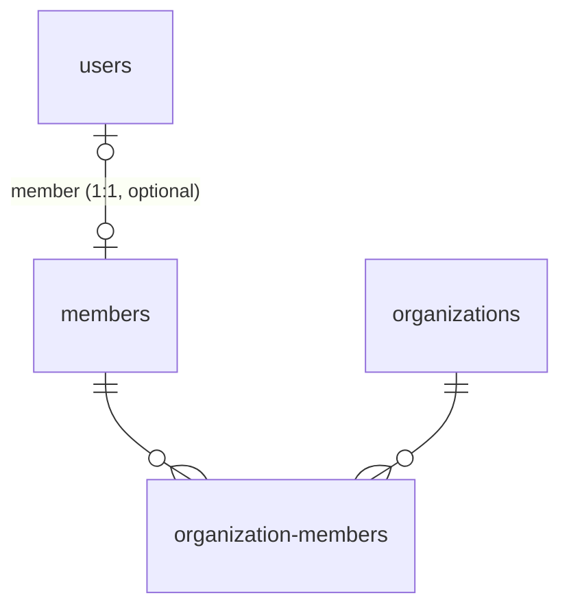

# Migration plan: WordPress → Payload (people and organisations)

Status: **draft**. Builds on [01-analysis.md](01-analysis.md); section references (§) point there.

Legend: **Proposed** = default we'll build unless someone objects. **Decide** = needs input before building that part.

---

## 1. Scope

**In scope**
- Login accounts (`wp_users`)
- Member profiles (CPT `member`)
- Organisations (CPT `community`) and who belongs to / administers them

**Deferred (later step, see §11):** the media files these records reference (avatars, logos, portfolio images,
certificates, documents). The migration keeps the WordPress attachment IDs so the files can be attached afterwards.

**Out of scope for this plan** (separate plans later): news posts, events, publications, pages, the **shop** (products, orders,
coupons, downloads, invoices), comments, SEO data.

**Target:** the existing Payload 3.94 app (Postgres, locales `de`/`en`). Today it has `users` (bare auth), `media` and `events`.

---

## 2. Target data model

### 2.1 Overview



| Collection | Purpose | From WP | Expected rows |
|---|---|---|---|
| `users` (auth) | Login only: email, password, roles | `wp_users` | ~1,215 (logins of non-migrated profiles dropped, §3.1) |
| `members` | A person's membership record and public profile | CPT `member` | ~1,290 (published profiles only, after dedupe) |
| `organizations` | Company, studio or school | CPT `community` | ~100 (published only) |
| `organization-members` | Link person ↔ organisation, with role `member`/`admin` | ACF `da_member_community(_admin)` | 181 (108 admins) |

### 2.2 Why keep `users` and `members` separate (Proposed)

WordPress already separates the login from the profile, and the data shows why the split is real rather than an artefact:
- **1,146 profiles have no login**: colleagues inside organisations, former members, contacts.
- **54 logins have no profile**: staff admins and a few buyers.
- Staff manage a member's record (status, fee, IBAN) independently of whether that person ever logs in.

Merging both into one auth collection would force a login (an email plus a dummy password) onto every profile, and would mix
admin-only membership data with the account. So:
- `users` stays an auth collection: `email`, `roles`, `member` (join field, read-only view of the linked profile), `legacyWpId`, and
  `legacyPasswordHash` (hidden) plus `legacyPasswordRetiredAt`, see §6.
- `members` has an optional, **unique** `user` relationship. That's the only place the link is stored, so the two sides can't disagree.
- One user ↔ at most one member. The 3 users linked to 2 profiles are resolved by the dedupe step (§4).

### 2.3 Roles and admin-panel access (Proposed)

A single `users` collection with `roles: ('admin' | 'staff' | 'member')[]`.
- `access.admin`: only `admin` and `staff` can open `/admin`.
- Members use the frontend (profile editing and the organisation page come later and aren't part of the migration).
- The 11 WP administrators get `admin`. Everyone else gets `member`.

### 2.4 `members` fields

| Payload field | Type | From WP (`da_member_*` unless noted) | Notes |
|---|---|---|---|
| `legacyWpId` | number, unique, indexed, read-only | `wp_posts.ID` | upsert key |
| `memberNumber` | text, indexed (**not unique**) | `id` | `000000*` → empty (placeholder); keep the `-N` suffix |
| `user` | relationship → users | `user` | dangling ids and `0` → empty |
| `profileStatus` | select `publish` / `pending` / `draft` / `private` | `post_status` | always `publish` after import (§3.1); staff can unpublish later |
| `slug` | text | `post_name` | for redirects from old profile URLs |
| `salutation` | select `d/f/m/i` | `gender` | |
| `title`, `firstName`, `lastName` | text | `title`, `firstname`, `lastname` | |
| `contactEmail`, `contactEmailPublic` | email, checkbox | `email`, `email_public` | separate from the login email |
| `birthdate` | date | `birthdate` | **staff-only** |
| `deathYear` | number | `deathyear` | |
| `tier`, `honorary`, `functions`, `boardTerms`, `bildrecht`, `newsletter` | see §3.2 | `status`, `board` | |
| `companyName` | text | `identity` | "Berufsidentität/Firmenname" |
| `jobTitle`, `employmentType` | text, select | `job`, `job_type` | |
| `about`, `motto`, `education`, `additionalQualification`, `otherFocus` | textarea | `about`, `motto`, `education`, `addition`, `owncat` | plain text in WP too |
| `keywords` | text | `keywords` | |
| `categories` | relationship → categories (hasMany) | `da_category` | see §3.4 |
| `legacy.avatarWpId` | number | `avatar` | WP attachment id; an upload field follows in §11 |
| `addresses[]` | array: type, street, number, zip, city, country, visibility | `da_address` repeater | |
| `phones[]` | array: type, number, visibility | `da_number` repeater | |
| `links[]` | array: type, url | `da_online` repeater | |
| `portfolio[]` | array: name, visibility, `imageWpIds` (json, hidden) | `da_portfolio` repeater | images follow in §11 |
| `documents[]` | array: type, name, `fileWpId` (hidden) | `da_documents` repeater | file follows in §11 |
| `legacy.studentProofWpId` | number, staff-only | `cert` | file follows in §11 |
| `billing` (group, **staff-only**) | paymentType, paymentFrequency, iban, feeOverride, feeNote | `payment_type`, `payment_frequency`, `iban`, `fee`, `fee_description` | frequency `year`→`yearly`, `trimester`→`quarterly` |
| `organizations` | join → organization-members | — | read-only view |
| `legacy` (group, hidden/collapsed) | createdAt, display opt-ins, motivation, activeFlag, mergedFromWpIds | `post_date`, `da_member_display`, `da_member_motivation`, status `active` | kept for traceability, can be dropped later |

Dropped: `da_member_rate` (hourly rate, 2 rows), theme colour fields (`da_*_color`, `da_sidebar`), recaptcha, Yoast meta, `_validate_email`, `da_new_notified`, `da_member_cancel` (always 0).

### 2.5 `organizations` fields

Same building blocks as members: `legacyWpId`, `memberNumber` (`da_community_id`), `name`, `slug`, `profileStatus` (always `publish` after import),
`partnerStatus` (select hasMany: `partner`/`premium`/`education`; drop the legacy `active`), `about`, `legacy.logoWpId`, `addresses[]`, `phones[]`,
`links[]`, `portfolio[]`, `documents[]`, `categories`, plus a `people` join → organization-members. Portfolio and documents follow the same pattern as on members (WP ids only).

### 2.6 `organization-members` fields

`organization` (rel, required), `member` (rel, required), `role` (`member` | `admin`), `legacyKey` (text, unique: `"<memberWpId>:<communityWpId>"`).
A unique compound index on (organization, member) gives one row per pair. The WP admin and member links are folded together, so admin implies member.
A separate collection, rather than a relationship array on either side, keeps a role per link, can be queried from both sides via
`join` fields, and makes "who may edit this organisation" a simple access check later.

### 2.7 Shared building blocks (Proposed)

- `src/fields/legacyWpId.ts`: field factory (number, unique, index, `admin.readOnly`, `admin.position: 'sidebar'`).
- `src/fields/contact.ts`: the `addresses`, `phones`, `links` and `portfolio` arrays used by both members and organisations.
- Schema changes are added as normal Payload migrations in `src/migrations/`. Only the **data import** lives in `migration/wordpress/`.

---

## 3. Transformation rules

### 3.1 Profile status: only published profiles are migrated

designaustria confirmed (November 2026): `pending` profiles are former members whose profile was deactivated when they
left. Keeping them is a data protection problem, so they are **not migrated**. The rule is: everything visible on the
current site is migrated (those are the paying members), nothing else.

- **Members:** only `publish`. `pending` (1,627), `draft` (11) and `private` (6) profiles are left out. That includes the
  newsletter-only contacts: 647 of the 651 profiles with `newsletter` are pending. The 4 published ones are migrated.
- **Organisations:** only `publish` (102 of 152). 12 published organisations end up without an admin, either because
  there never was one (designforum Wien, heiderklausner, CIDCOM, Extraplan, Atomic) or because their admin is pending
  (Print Alliance, FH Vorarlberg, WIFI Wien, BLAHA, Edera Safety, rolf.produktions, Yuniti). They are migrated without one.
- **Links:** a link is migrated only if both the person and the organisation are. People who are pending inside a
  published organisation (25 people, 18 organisations) drop out of its people list.
- **Logins:** a login linked only to profiles that aren't migrated is dropped too (617). Admins and logins without any
  profile (staff, some shop customers) are kept.
- **Merges run first** (§4), then the filter. So a published profile still gets the login and tier from its pending
  duplicate. The extract fails if a merge rule would fold a published profile into one that isn't migrated.
- `deathYear` is migrated as a field; it doesn't change the status.

Code: `lib/published.ts`. The extract prints what was left out (`notMigrated` in `_report.json`), and warnings about
records that aren't migrated are left out of the report.

### 3.2 Splitting `da_member_status` (Proposed)

The one multi-checkbox becomes separate fields:

| WP value | Payload |
|---|---|
| `standard`, `yp`, `student`, `retiree` | `tier` = `standard` / `youngProfessional` / `student` / `retiree` |
| `community` | `tier` = `corporate` (company contact or colleague) |
| `institute` | `tier` = `education` |
| `honorary` | `honorary` = `member` |
| `president` | `honorary` = `president` |
| `team` | `functions` includes `staff` |
| `board` | `functions` includes `board`; `boardTerms` from `da_member_board` |
| `bildrecht` | `bildrecht` = true |
| `newsletter` | `newsletter` = true |
| `active` (legacy) | `legacy.activeFlag` = true (meaning unknown, kept so nothing is lost) |

`tier` is single-valued. 6 profiles have two tier flags (for example `standard` + `community`). Rule: a `community` link wins
(they're a corporate contact); otherwise keep the first and log it for review.

### 3.3 Relationship field formats

`da_member_community`, `da_member_community_admin` and every ACF post-object or gallery field: accept both a PHP-serialised array
and a bare ID. One `parseIdList()` helper in `lib/` handles both and is unit-tested.

### 3.4 Categories (Proposed)

Members and organisations reference WP `category` terms (focus areas and regions, e.g. "Wien"). Import only the terms actually
used by members and organisations into a new `categories` collection (with `legacyWpId` and `parent`), so news and events can
reuse it in their own migration later. Terms that no longer exist (e.g. id 174) are logged and skipped.

### 3.5 Text cleanup

- Decode HTML entities (`HFA-Studio GmbH &amp; Co KG`).
- Trim whitespace; empty string → `null`.
- Country: keep the ISO code if present, otherwise map free text ("Österreich", typos like "Österrich", Austrian states → `AT`),
  and log anything unmapped. `scripts/analyze/check-helpers.ts` lists unmapped values for each new dump.
- Phone type `fax` (198 rows, no longer an ACF choice) is kept as its own type.
- URLs: add `https://` where it's missing; log invalid ones.

---

## 4. Duplicate handling

The rules come from the duplicate analysis in §3 of 01-analysis.md. They're applied in the extract stage, before the
status filter (§3.1), so the JSON that import reads is already deduplicated. Where both profiles are pending (bulk copies
3669 and 5086), the merged result is left out like any other pending profile.

| Pattern | Rule |
|---|---|
| `000000-N` placeholder collisions | Not duplicates. Import all; `memberNumber` empty. |
| Bulk copy (IDs 25015–25022) | **Merge** into the original: profile content from the original, `user` from the copy, `tier` from the copy, `honorary` from the original. Record the copy's id in `legacy.mergedFromWpIds`. |
| Re-registration | **Merge** into the newer profile (it has the login); the old profile's id goes to `mergedFromWpIds`. |
| Duplicate Post clones | Per case: merge if it's the same person, otherwise `unlinkUser` when the clone kept the original's login. |

The decisions live in `config/merges.json`, reviewed and committed, so reruns are deterministic:

- `merges`: `{ keep, mergeFrom, takeFromMerged?, reason, review? }`. `takeFromMerged` lists fields copied from the merged
  posts (e.g. `user`, `tier` for bulk copies); everything else comes from `keep`.
- `unlinkUser`: `{ member, reason }` drops a wrong login link (member 31740, a clone of another person that kept user 231).
- `review: true` marks a provisional decision; the extract prints it as a warning on every run until it's confirmed.
  Currently provisional: users 173 and 510 (each linked to two profiles of what looks like one person) and member nr 110001.
- Organisation links of a merged-away profile move to the profile that's kept.

The extract fails if a rule points to a profile that doesn't exist, or if a login would still be linked to two members.

---

## 5. Decisions needed before building

These come from §8 of 01-analysis.md. They block only the parts noted.

1. **Fee collection**: is there an external system (accounting tool or SEPA export) that reads IBAN and frequency? Decides whether `billing` should be authoritative in Payload or a sync target.
2. **Community admin rights**: label only, or edit rights? Doesn't block the import (the role is migrated either way); it blocks access control.
3. **Passwords**: transparent upgrade on first login, or a "set your password" mail to everyone at launch (§6)? Current
   decision: transparent upgrade, built in step 4. Still open: how many months to keep the WordPress hashes (§6 point 4),
   and whether to mail members anyway at launch.
4. **Newsletter list**: the 647 newsletter contacts aren't migrated (§3.1). Is the list kept in the newsletter tool
   (Mailchimp)? Otherwise the addresses are gone after cutover.
5. **Edge cases of the "published only" rule** (§3.1):
   - The *designaustria* organisation (the staff team, 3 published admins) is pending, so it isn't migrated. Intended?
   - 3 published profiles have only the status `newsletter` (WP 3498, 4269, 4489). They're migrated as visible members. Wrongly flagged?
   - Logins without any profile (43 with the `member` role, 12 of them with shop orders) are still migrated. Keep them,
     or are they also former members?

---

## 6. Passwords and first login

WP hashes can't be checked by Payload's local strategy. The real dump may contain two formats: phpass (`$P$…`, every row in
the anonymised dump) and WordPress ≥ 6.8 bcrypt (`$wp$2y$…`).

**Built: transparent upgrade** (step 4)
1. The import creates each user with a random, unusable Payload password and stores the WP hash in `legacyPasswordHash`
   (hidden; not readable or writable through the API or admin, staff included).
2. On login, a `beforeOperation` hook on `users` (`src/auth/legacyPassword.ts`) runs before Payload checks the password. If the
   user has a WP hash, isn't locked out, and the password matches it (phpass, `$wp$` bcrypt, plain bcrypt or MD5, the same
   formats `wp_check_password()` accepts), the password becomes the user's Payload password, the hash is cleared and
   `legacyPasswordRetiredAt` is set. Payload's normal login then succeeds.
   - It's a hook in Payload's login operation, not a separate endpoint, so the admin panel, REST, GraphQL and the Local API
     all get it, and the frontend uses the standard `/api/users/login`.
   - A wrong password changes nothing: Payload's normal login fails and counts the attempt (5 attempts, 10 min lockout).
3. "Forgot password" works as normal for everyone. Any new password (reset, account settings, admin) also clears the WP hash
   and sets `legacyPasswordRetiredAt`, so an old WordPress password can never replace one set on the new site.
4. After N months, clear any remaining legacy hashes; those users use "forgot password".

The import writes the WordPress hash on every run, so WordPress stays the source of truth until cutover, **except** for users
with `legacyPasswordRetiredAt` set: they already have a password on the new site, so their hash is never written again. Verify
checks both (hash count, and no hash on a retired user). Staff see the date as "Password set on new site" in the user sidebar.

Tests: `tests/int/wordpress-password.int.spec.ts` checks the hash code against hashes made by WordPress's own code
(`tests/fixtures/wordpress-password-hashes.json`, test passwords only); `tests/int/legacy-login.int.spec.ts` covers the login
flow (upgrade, second login, wrong password, lockout, change, reset, no access to the hidden fields).

Alternative: drop the hashes and send everyone a "set your password" mail at launch. It's simpler, but every member has to act
at launch, and outdated email addresses lead to support requests.

---

## 7. Pipeline

```
00-load-dump.sh      SQL dump → MySQL (container)
extract/*.ts         MySQL → .data/wp-extract/*.json        (clean, deduplicated, Payload-shaped, no Payload IDs)
import/*.ts          JSON  → Payload Local API               (wipe, then create; relations resolved by legacyWpId)
verify/*.ts          WP counts ↔ Payload counts, report     (fails on mismatch)
```

- **Language:** TypeScript, run with `tsx` (`npm run wp:extract|wp:import|wp:verify`). `payload run` drops command-line flags,
  so the scripts load `.env` and the Payload config themselves (`scripts/lib-env.ts`).
  New dev dependency: `mysql2`. PHP unserialise is a small in-house parser in `lib/` (plus tests), since the values are simple.
- **Extract** is pure: same dump → byte-identical JSON (sorted keys and rows). Every record carries `legacyWpId`. Warnings
  (dangling refs, unmapped values, merges) go to `.data/wp-extract/_report.json`.
- **Import order:** `categories` → `users` → `organizations` → `members` → `organization-members`.
- **Wipe first:** a full import deletes everything a previous import wrote (users, members, organisations, links,
  categories) in one transaction, then imports the extract (`scripts/import/wipe.ts`). So every run gives exactly the
  extract: records removed in WordPress or no longer migrated (§3.1) don't linger. **Kept:** accounts made on the new site
  for the team (no `legacyWpId`, role `admin` or `staff`). `verify` fails if anything outside the extract is left.
  Payload ids change on every run, so nothing outside the import may point to these records by id until go-live.
- **Upsert:** records are still written with `find({ where: { legacyWpId: { equals } } })`, then `update` or `create`.
  With `--only=<collection>` nothing is wiped and only the upsert runs (for fixing one collection). Also `--dry-run`.
- **Media:** not imported in this migration. Extract and import only carry the WP attachment ids (`*WpId` fields), see §11.
- **Side effects off:** imports pass `context: { isMigration: true }`, and hooks that send emails or ping external services must
  skip when that flag is set. Payload's verification and welcome emails are disabled for imported users.

### Folder additions

```
migration/wordpress/
├── config/merges.json            reviewed duplicate merges
├── lib/                          mysql client, php-unserialize, parseIdList, upsert, mappers
├── scripts/lib-env.ts            Payload startup: local-DB guard, no schema push, migrations up-to-date check
├── scripts/extract/              run.ts + one module per collection
├── scripts/import/run.ts         wipe, then all collections in dependency order, --dry-run / --only=
├── scripts/import/wipe.ts        deletes previously imported data, keeps the team's own accounts
└── scripts/verify/run.ts
```

---

## 8. Environments and cutover

1. **Develop** against the anonymised dump and a local Postgres. The anonymised data is enough to build and test everything except real password checks.
2. **Staging rehearsal** with a fresh *real* dump on a staging DB. The real dump is handled only on staging and the machine running
   the import, and it is never committed (`.data/` is gitignored).
3. **Cutover:** freeze WP (maintenance mode, or at least no new registrations or profile edits), take a final dump, run load → extract →
   import → verify on production, then set up redirects from old member and organisation URLs (`/member/<slug>` → new route).
4. Because a full import wipes first, a rerun with a newer dump always gives a clean copy, so a last-minute run before go-live is cheap.
5. **After go-live the import must not run again** on production: the wipe would delete everything members and staff
   changed on the new site, including passwords set there.

---

## 9. Verification

`verify/counts.ts` checks, and fails on any mismatch:
- users: WP count = Payload count; every WP admin has role `admin`
- members: published WP profiles − merged = Payload count; every merged id appears in some `mergedFromWpIds`
- every member→user link from WP exists in Payload (except the logged dangling ones)
- organisation links: equal to `organization-members.json` (181 rows on the anonymised dump, 108 with role `admin`, after merges and the status filter)
- spot checks: 20 random members, rendered side by side (WP JSON vs Payload doc) in a report

---

## 10. Build order

1. Schema: `legacyWpId` and contact field helpers; `users` roles and access; `members`, `organizations`,
   `organization-members`, `categories`; Payload migration.
2. `lib/` and unit tests (`parseIdList`, unserialise, status split, merges).
3. Extract and import for categories, users, organisations, members and links, using the anonymised dump. Verify.
4. Legacy login: WordPress password checked on first login, then moved to Payload (§6). Done.
5. Staging rehearsal with the real dump, then cutover.

Steps 1–3 can start now; none of the open decisions in §5 block them.

---

## 11. Later: media files (not part of this migration yet)

The people and organisations migration runs **without files**. Profiles are imported with the WordPress attachment ids
(`legacy.avatarWpId`, `legacy.logoWpId`, `legacy.studentProofWpId`, `portfolio[].imageWpIds`, `documents[].fileWpId`), so a separate media step can
attach the files afterwards without re-extracting or touching the rest of the data.

**This step still has to be done**, and it must be finished before go-live if the new site shows member or organisation profiles.
Otherwise profiles launch without avatars, logos and portfolios.

What's already known, so the step can be picked up later. There's no uploads export, but the files can be inferred from the
dump and fetched from the live site (numbers: `scripts/analyze/05-media.sql`):

- URL = `https://www.designaustria.at/wp-content/uploads/` + `_wp_attached_file`. Uploads are flat (no `yyyy/mm`), which
  was confirmed with a request for a public logo. For images WordPress downscaled (`-scaled`), fetch `original_image` from
  `_wp_attachment_metadata` instead (110 files).
- **Manifest:** `extract/` writes `.data/wp-extract/media-manifest.json` with only the attachments referenced by migrated members and organisations:
  attachment id, path, URL, mime type, role (`image` / `portfolio` / `cert` / `document`), owner. That's about 12,000 files and 5–6 GB,
  of which 11,000 are portfolio images. The other ~10,500 attachments in WP belong to news, events and the shop, and are left out.
- **`scripts/fetch-media.ts`** downloads into `.data/wp-uploads/<path>`:
  - Idempotent: it skips files that already exist with the same size. Use `--refresh` to recheck with `If-Modified-Since`.
  - Polite: 2–4 parallel requests, retry with backoff, run off-hours.
  - Reports 404s and other failures to `.data/wp-extract/_media-report.json`. Missing files are logged and skipped.
- **Attach:** `role = cert | document` → `private-files` (staff-only); everything else → `media`. The alt text comes from the WP attachment's
  alt meta, falling back to the title. Upserted by `legacyWpId` (the attachment id). Then replace the `*WpId` fields with real upload fields that point to the imported files.
- WooCommerce downloads (`woocommerce_uploads/`) are shop-only and out of scope.
- At cutover the fetch runs again against the final dump, which only downloads new files.
- Needs: a new `private-files` upload collection (staff-only) and upload fields on `members` and `organizations`.

**Open before starting:**
- Is it OK to download about 12,000 files (5–6 GB) from the live site, and when? Or can the hoster provide the `wp-content/uploads` folder instead?
- Are certificates publicly reachable by URL today? If so, that's a privacy issue on the current site regardless of the migration.
