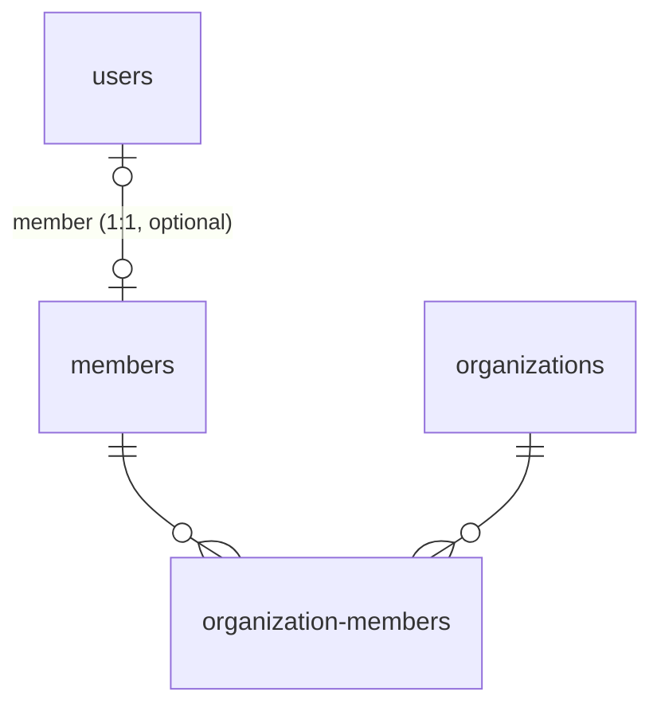

# Migration plan: WordPress → Payload (people and organisations)

Status: **draft**. Builds on [01-analysis.md](01-analysis.md); section references (§) point there.

Legend: **Proposed** = default we'll build unless someone objects. **Decide** = needs input before building that part.

---

## 1. Scope

**In scope**
- Login accounts (`wp_users`)
- Member profiles (CPT `member`)
- Organisations (CPT `community`) and who belongs to / administers them

**Deferred (later step, see §11):** the media files these records reference (avatars, logos, portfolio images,
certificates, documents). The migration keeps the WordPress attachment IDs so the files can be attached afterwards.

**Out of scope for this plan** (separate plans later): news posts, events, publications, pages, the **shop** (products, orders,
coupons, downloads, invoices), comments, SEO data.

**Target:** the existing Payload 3.94 app (Postgres, locales `de`/`en`). Today it has `users` (bare auth), `media` and `events`.

---

## 2. Target data model

### 2.1 Overview



| Collection | Purpose | From WP | Expected rows |
|---|---|---|---|
| `users` (auth) | Login only: email, password, roles | `wp_users` | ~1,830 |
| `members` | A person's membership record and public profile | CPT `member` | ~2,930 after dedupe (fewer if §5 excludes contacts) |
| `organizations` | Company, studio or school | CPT `community` | ~150 |
| `organization-members` | Link person ↔ organisation, with role `member`/`admin` | ACF `da_member_community(_admin)` | 302 |

### 2.2 Why keep `users` and `members` separate (Proposed)

WordPress already separates the login from the profile, and the data shows why the split is real rather than an artefact:
- **1,146 profiles have no login**: colleagues inside organisations, former members, contacts.
- **54 logins have no profile**: staff admins and a few buyers.
- Staff manage a member's record (status, fee, IBAN) independently of whether that person ever logs in.

Merging both into one auth collection would force a login (an email plus a dummy password) onto every profile, and would mix
admin-only membership data with the account. So:
- `users` stays an auth collection: `email`, `roles`, `member` (relationship, unique, optional), `legacyWpId`, and
  `legacyPasswordHash` (hidden, see §6).
- `members` has an optional `user` relationship. A `join` field on `users` shows the linked profile.
- One user ↔ at most one member. The 3 users linked to 2 profiles are resolved by the dedupe step (§4).

### 2.3 Roles and admin-panel access (Proposed)

A single `users` collection with `roles: ('admin' | 'staff' | 'member')[]`.
- `access.admin`: only `admin` and `staff` can open `/admin`.
- Members use the frontend (profile editing and the organisation page come later and aren't part of the migration).
- The 11 WP administrators get `admin`. Everyone else gets `member`.

### 2.4 `members` fields

| Payload field | Type | From WP (`da_member_*` unless noted) | Notes |
|---|---|---|---|
| `legacyWpId` | number, unique, indexed, read-only | `wp_posts.ID` | upsert key |
| `memberNumber` | text, indexed (**not unique**) | `id` | `000000*` → empty (placeholder); keep the `-N` suffix |
| `user` | relationship → users | `user` | dangling ids and `0` → empty |
| `state` | select | `post_status` + status flags | see §3.1 |
| `publicProfile` | checkbox | `post_status = publish` | |
| `slug` | text | `post_name` | for redirects from old profile URLs |
| `salutation` | select `d/f/m/i` | `gender` | |
| `title`, `firstName`, `lastName` | text | `title`, `firstname`, `lastname` | |
| `contactEmail`, `contactEmailPublic` | email, checkbox | `email`, `email_public` | separate from the login email |
| `birthdate` | date | `birthdate` | **staff-only** |
| `deathYear` | number | `deathyear` | |
| `tier`, `honorary`, `functions`, `boardTerms`, `bildrecht`, `newsletter` | see §3.2 | `status`, `board` | |
| `companyName` | text | `identity` | "Berufsidentität/Firmenname" |
| `jobTitle`, `employmentType` | text, select | `job`, `job_type` | |
| `about`, `motto`, `education`, `additionalQualification`, `otherFocus` | textarea | `about`, `motto`, `education`, `addition`, `owncat` | plain text in WP too |
| `hourlyRate` | number | `rate` | 2 rows; probably drop |
| `keywords` | text | `keywords` | |
| `categories` | relationship → categories (hasMany) | `da_category` | see §3.4 |
| `avatarWpId` | number, hidden | `avatar` | WP attachment id; replaced by an upload field in §11 |
| `addresses[]` | array: type, street, number, zip, city, country, visibility | `da_address` repeater | |
| `phones[]` | array: type, number, visibility | `da_number` repeater | |
| `links[]` | array: type, url | `da_online` repeater | |
| `portfolio[]` | array: name, visibility, `imageWpIds` (json, hidden) | `da_portfolio` repeater | images follow in §11 |
| `documents[]` | array: type, name, `fileWpId` (hidden) | `da_documents` repeater | file follows in §11 |
| `studentProofWpId` | number, hidden | `cert` | file follows in §11 |
| `billing` (group, **staff-only**) | paymentType, frequency, iban, feeOverride, feeNote | `payment_type`, `payment_frequency`, `iban`, `fee`, `fee_description` | |
| `organizations` | join → organization-members | — | read-only view |
| `legacy` (group, hidden/collapsed) | createdAt, display opt-ins, motivation, mergedFromWpIds | `post_date`, `da_member_display`, `da_member_motivation` | kept for traceability, can be dropped later |

Dropped: theme colour fields (`da_*_color`, `da_sidebar`), recaptcha, Yoast meta, `_validate_email`, `da_new_notified`, `da_member_cancel` (always 0).

### 2.5 `organizations` fields

Same building blocks as members: `legacyWpId`, `memberNumber` (`da_community_id`), `name`, `slug`, `state`, `publicProfile`,
`partnerStatus` (select hasMany: `partner`/`premium`/`education`; drop the legacy `active`), `about`, `logoWpId` (hidden), `addresses[]`, `phones[]`,
`links[]`, `portfolio[]`, `documents[]`, `categories`, plus a `people` join → organization-members. Portfolio and documents follow the same pattern as on members (WP ids only).

### 2.6 `organization-members` fields

`organization` (rel, required), `member` (rel, required), `role` (`member` | `admin`), `legacyKey` (text, unique: `"<memberWpId>:<communityWpId>"`).
A unique compound index on (organization, member) gives one row per pair. The WP admin and member links are folded together, so admin implies member.
A separate collection, rather than a relationship array on either side, keeps a role per link, can be queried from both sides via
`join` fields, and makes "who may edit this organisation" a simple access check later.

### 2.7 Shared building blocks (Proposed)

- `src/fields/legacyWpId.ts`: field factory (number, unique, index, `admin.readOnly`, `admin.position: 'sidebar'`).
- `src/fields/contact.ts`: the `addresses`, `phones`, `links` and `portfolio` arrays used by both members and organisations.
- Schema changes are added as normal Payload migrations in `src/migrations/`. Only the **data import** lives in `migration/wordpress/`.

---

## 3. Transformation rules

### 3.1 Member `state` (Decide; depends on question 1 in §8 of the analysis)

| WP | Proposed `state` |
|---|---|
| `publish` | `active` |
| `private` | `active` (not public) |
| `pending` with a login | `inactive`, pending confirmation of what `pending` means |
| `pending` without a login, status only `newsletter` (560) | **not migrated**, see §5, question 2 |
| `pending` without a login, other statuses | `former` |
| `draft` | `applicant` |
| `deathyear` set | `deceased` (overrides the above) |

### 3.2 Splitting `da_member_status` (Proposed)

The one multi-checkbox becomes separate fields:

| WP value | Payload |
|---|---|
| `standard`, `yp`, `student`, `retiree` | `tier` = `standard` / `youngProfessional` / `student` / `retiree` |
| `community` | `tier` = `corporate` (company contact or colleague) |
| `institute` | `tier` = `education` |
| `honorary` | `honorary` = `member` |
| `president` | `honorary` = `president` |
| `team` | `functions` includes `staff` |
| `board` | `functions` includes `board`; `boardTerms` from `da_member_board` |
| `bildrecht` | `bildrecht` = true |
| `newsletter` | `newsletter` = true (or Mailchimp only, §5, question 2) |
| `active` (legacy) | dropped; it only means "was active", which `state` already covers |

`tier` is single-valued. 6 profiles have two tier flags (for example `standard` + `community`). Rule: a `community` link wins
(they're a corporate contact); otherwise keep the first and log it for review.

### 3.3 Relationship field formats

`da_member_community`, `da_member_community_admin` and every ACF post-object or gallery field: accept both a PHP-serialised array
and a bare ID. One `parseIdList()` helper in `lib/` handles both and is unit-tested.

### 3.4 Categories (Proposed)

Members and organisations reference WP `category` terms (focus areas and regions, e.g. "Wien"). Import only the terms actually
used by members and organisations into a new `categories` collection (with `legacyWpId` and `parent`), so news and events can
reuse it in their own migration later. Terms that no longer exist (e.g. id 174) are logged and skipped.

### 3.5 Text cleanup

- Decode HTML entities (`HFA-Studio GmbH &amp; Co KG`).
- Trim whitespace; empty string → `null`.
- Country: keep the ISO code if present, otherwise map free text ("Österreich" → `AT`), and log anything unmapped.
- URLs: add `https://` where it's missing; log invalid ones.

---

## 4. Duplicate handling

The rules come from the duplicate analysis in §3 of 01-analysis.md. They're applied in the extract stage, so the JSON that import reads is already deduplicated.

| Pattern | Rule |
|---|---|
| `000000-N` placeholder collisions | Not duplicates. Import all; `memberNumber` empty. |
| Bulk copy (IDs 25015–25022) | **Merge** into the original: profile content from the original, `user` from the copy, `tier` from the copy, `honorary` from the original. Record the copy's id in `legacy.mergedFromWpIds`. |
| Re-registration | **Merge** into the newer profile (it has the login); the old profile's id goes to `mergedFromWpIds`. |
| Duplicate Post clones | Per case, via the overrides file. |

Auto-detection only proposes merges. The final list lives in `migration/wordpress/config/merges.json`
(`{ "keep": 5502, "mergeFrom": [25016], "note": "bulk copy" }`), which is reviewed and committed, so reruns are deterministic.
The extract step fails if a user would end up linked to two members after merging.

---

## 5. Decisions needed before building

These come from §8 of 01-analysis.md. They block only the parts noted.

1. **What `pending` means** → `state` mapping (§3.1).
2. **Newsletter-only contacts** (560): not migrating is proposed (data minimisation; they belong in the newsletter tool). Blocks: member extract filter.
3. **Fee collection**: is there an external system (accounting tool or SEPA export) that reads IBAN and frequency? Decides whether `billing` should be authoritative in Payload or a sync target.
4. **Community admin rights**: label only, or edit rights? Doesn't block the import (the role is migrated either way); it blocks access control.
5. **Passwords**: see §6.

---

## 6. Passwords and first login

WP hashes can't be checked by Payload's local strategy. The real dump may contain two formats: phpass (`$P$…`, every row in
the anonymised dump) and WordPress ≥ 6.8 bcrypt (`$wp$2y$…`).

**Proposed: transparent upgrade**
1. Import each user with a random, unusable Payload password and store the WP hash in `legacyPasswordHash` (hidden, staff can't read it).
2. A custom login endpoint first tries the normal Payload login. If that fails and `legacyPasswordHash` is set, it verifies the
   password against the WP hash (phpass or `$wp$` bcrypt). On success it sets it as the Payload password, clears
   `legacyPasswordHash`, and logs the user in.
3. "Forgot password" works as normal for everyone.
4. After N months, clear any remaining legacy hashes; those users use "forgot password".

Alternative: drop the hashes and send everyone a "set your password" mail at launch. It's simpler, but every member has to act
at launch, and outdated email addresses lead to support requests.

---

## 7. Pipeline

```
00-load-dump.sh      SQL dump → MySQL (container)
extract/*.ts         MySQL → .data/wp-extract/*.json        (clean, deduplicated, Payload-shaped, no Payload IDs)
import/*.ts          JSON  → Payload Local API               (upsert by legacyWpId, resolve relations by legacyWpId)
verify/*.ts          WP counts ↔ Payload counts, report     (fails on mismatch)
```

- **Language:** TypeScript, run with `payload run <script>` so the Payload config and `.env` load just as they do in the app.
  New dev dependency: `mysql2`. PHP unserialise is a small in-house parser in `lib/` (plus tests), since the values are simple.
- **Extract** is pure: same dump → byte-identical JSON (sorted keys and rows). Every record carries `legacyWpId`. Warnings
  (dangling refs, unmapped values, merges) go to `.data/wp-extract/_report.json`.
- **Import order:** `categories` → `users` → `organizations` → `members` → `organization-members`
  → post-pass setting `users.member`.
- **Upsert:** `find({ where: { legacyWpId: { equals } } })`, then `update` or `create`. Batched, with `--dry-run` and `--only=<collection>`.
  A rerun never duplicates; it updates changed values.
- **Records removed in WordPress** between runs aren't deleted automatically; `verify` lists them.
- **Media:** not imported in this migration. Extract and import only carry the WP attachment ids (`*WpId` fields), see §11.
- **Side effects off:** imports pass `context: { isMigration: true }`, and hooks that send emails or ping external services must
  skip when that flag is set. Payload's verification and welcome emails are disabled for imported users.

### Folder additions

```
migration/wordpress/
├── config/merges.json            reviewed duplicate merges
├── lib/                          mysql client, php-unserialize, parseIdList, upsert, mappers
├── scripts/extract/              one script per collection, numbered in import order
├── scripts/import/               idem
└── scripts/verify/counts.ts
```

---

## 8. Environments and cutover

1. **Develop** against the anonymised dump and a local Postgres. The anonymised data is enough to build and test everything except real password checks.
2. **Staging rehearsal** with a fresh *real* dump on a staging DB. The real dump is handled only on staging and the machine running
   the import, and it is never committed (`.data/` is gitignored).
3. **Cutover:** freeze WP (maintenance mode, or at least no new registrations or profile edits), take a final dump, run load → extract →
   import → verify on production, then set up redirects from old member and organisation URLs (`/member/<slug>` → new route).
4. Because the import is idempotent, a rerun with a newer dump only adds and updates, so a last-minute delta run before go-live is cheap.

---

## 9. Verification

`verify/counts.ts` checks, and fails on any mismatch:
- users: WP count − excluded = Payload count; every WP admin has role `admin`
- members: WP count − excluded − merged = Payload count; every merged id appears in some `mergedFromWpIds`
- every member→user link from WP exists in Payload (except the logged dangling ones)
- organisation links: 302 rows (distinct member ∪ admin pairs), 132 with role `admin`
- spot checks: 20 random members, rendered side by side (WP JSON vs Payload doc) in a report

---

## 10. Build order

1. Schema: `legacyWpId` and contact field helpers; `users` roles and access; `members`, `organizations`,
   `organization-members`, `categories`; Payload migration.
2. `lib/` and unit tests (`parseIdList`, unserialise, status split, merges).
3. Extract and import for categories, users, organisations, members and links, using the anonymised dump. Verify.
4. Legacy login endpoint (§6).
5. Staging rehearsal with the real dump, then cutover.

Steps 1–3 can start now. Only the `state` mapping (question 1) and the newsletter filter (question 2) are provisional until those answers come in.

---

## 11. Later: media files (not part of this migration yet)

The people and organisations migration runs **without files**. Profiles are imported with the WordPress attachment ids
(`avatarWpId`, `logoWpId`, `studentProofWpId`, `portfolio[].imageWpIds`, `documents[].fileWpId`), so a separate media step can
attach the files afterwards without re-extracting or touching the rest of the data.

**This step still has to be done**, and it must be finished before go-live if the new site shows member or organisation profiles.
Otherwise profiles launch without avatars, logos and portfolios.

What's already known, so the step can be picked up later. There's no uploads export, but the files can be inferred from the
dump and fetched from the live site (numbers: `scripts/analyze/05-media.sql`):

- URL = `https://www.designaustria.at/wp-content/uploads/` + `_wp_attached_file`. Uploads are flat (no `yyyy/mm`), which
  was confirmed with a request for a public logo. For images WordPress downscaled (`-scaled`), fetch `original_image` from
  `_wp_attachment_metadata` instead (110 files).
- **Manifest:** `extract/` writes `.data/wp-extract/media-manifest.json` with only the attachments referenced by migrated members and organisations:
  attachment id, path, URL, mime type, role (`image` / `portfolio` / `cert` / `document`), owner. That's about 12,000 files and 5–6 GB,
  of which 11,000 are portfolio images. The other ~10,500 attachments in WP belong to news, events and the shop, and are left out.
- **`scripts/fetch-media.ts`** downloads into `.data/wp-uploads/<path>`:
  - Idempotent: it skips files that already exist with the same size. Use `--refresh` to recheck with `If-Modified-Since`.
  - Polite: 2–4 parallel requests, retry with backoff, run off-hours.
  - Reports 404s and other failures to `.data/wp-extract/_media-report.json`. Missing files are logged and skipped.
- **Attach:** `role = cert | document` → `private-files` (staff-only); everything else → `media`. The alt text comes from the WP attachment's
  alt meta, falling back to the title. Upserted by `legacyWpId` (the attachment id). Then replace the `*WpId` fields with real upload fields that point to the imported files.
- WooCommerce downloads (`woocommerce_uploads/`) are shop-only and out of scope.
- At cutover the fetch runs again against the final dump, which only downloads new files.
- Needs: a new `private-files` upload collection (staff-only) and upload fields on `members` and `organizations`.

**Open before starting:**
- Is it OK to download about 12,000 files (5–6 GB) from the live site, and when? Or can the hoster provide the `wp-content/uploads` folder instead?
- Are certificates publicly reachable by URL today? If so, that's a privacy issue on the current site regardless of the migration.
